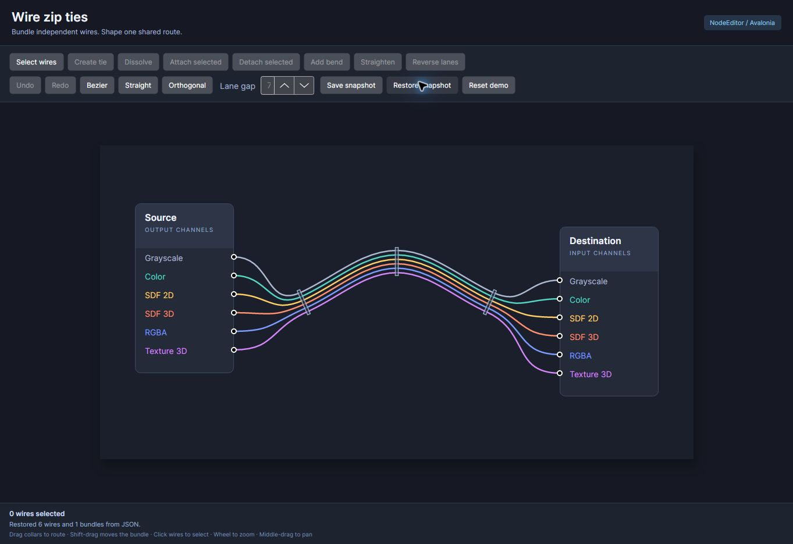

# Wire zip-tie validation

Validation was performed on 2026-10-25 against the implementation in
`feature/wire-zip-ties`.
The checks use the real Avalonia controls and .NET models, including the
WebAssembly sample.

## Automated checks

| Check | Result |
| --- | --- |
| Release solution build | Passed; zero errors across all projects and target frameworks |
| Unit and Avalonia Headless tests | 100 passed, zero failed, zero skipped |
| Release WebAssembly publish | Passed; static assets produced in `wwwroot` |
| Whitespace validation | `git diff --check` passed |

Test coverage is divided as follows:

| Suite | Cases | Coverage |
| --- | ---: | --- |
| `ZipTieModelTests` | 30 | Eligibility, membership, commands, locks, normalization, persistence, history, clipboard topology, and graph-transfer subscriptions |
| `ZipTieGeometryTests` | 21 | Parallel lanes, all route styles, reversed endpoints, rotated pins, intermediate collars, exact insertion intervals, and finite degenerate geometry |
| `ZipTieInteractionTests` | 29 | Real editor templates, pointer and keyboard gestures, transformed coordinates, drag transactions, cancellation, capture loss, context-menu bindings, selection, and node movement |
| `ZipTieRenderingTests` | 9 | Collars, subscriptions, selection/export scopes, drawing replacement and behavior-detachment cleanup, and spatial hit-test invalidation |
| `ZipTieDemoTests` | 6 | Sample construction, tools, styles, snapshots, and socket title/subtitle preservation through undo and redo |
| Existing `ConnectionRulesTests` | 5 | Existing connection-rule regressions |

The local validation used .NET SDK 10.0.403 and its `wasm-tools` workload. The
solution build covers the existing `netstandard2.0`, `net6.0`, `net8.0`, and
`net10.0` library targets, both desktop samples, and the new `net10.0-browser`
sample. Existing dependency warnings remain, including the
`Microsoft.Build.Tasks.Git` 10.0.102 NU1902 warning and transitive package support
warnings for `net6.0`.

Reproduce from the repository root:

```sh
dotnet workload install wasm-tools
dotnet build NodeEditor.slnx -c Release
dotnet test tests/NodeEditorAvalonia.UnitTests/NodeEditorAvalonia.UnitTests.csproj -c Release --logger "trx;LogFileName=zip-ties.trx"
dotnet publish samples/NodeEditor.Web/NodeEditor.Web.csproj -c Release -o artifacts/browser
```

## Interactive browser checks

The published sample was served as static files and exercised in Chrome. This
was an actual WebAssembly run, with pointer actions against the rendered
Avalonia editor.

| Interaction | Observed result |
| --- | --- |
| Drag an end collar | All six wire lanes reshape together; endpoints and colors remain intact |
| Undo and redo the drag | Original and edited geometry are restored; both node titles and subtitles survive |
| Double-click the shared span | An intermediate collar is inserted on the rendered span |
| Drag the intermediate collar | The parallel lanes follow a smooth shared bend with updated fan-outs |
| Switch between Bezier, orthogonal, and straight | Every wire follows the requested route style through the same collars |
| Dissolve the bundle | The collars disappear and all six independent connections remain |
| Select the wires and create a new tie | A new bundle forms with stable lane order and two end collars |
| Save, select all wires, and restore a snapshot | Six colored wires and three collars are restored with titles intact and no stale selection overlays |

The final browser capture shows the restored JSON snapshot after selection
overlays from the previous drawing have been removed:



Shift-drag, keyboard nudging, Escape cancellation, capture loss, text-input
exclusions, membership changes, and context-menu commands are covered by the
Avalonia Headless interaction tests. They are separate from the browser checks
listed above.

This browser used Avalonia's software rendering fallback because accelerated
canvas contexts were unavailable. GPU rendering performance was not measured.

## Curve-flattening allocation profile

An isolated optimized harness compared the exact cubic sampler and array-to-list
wrapper from baseline `e2cd7a6` with a fresh `ConnectorPath`, `CubicTo(...)`, and
`Flatten(0.35)`. It used .NET 10.0.14 x64, disabled tiered compilation, warmed each
case 25 times, and measured 100 routes with
`GC.GetAllocatedBytesForCurrentThread`.

For length `L`, both implementations received the same control points. The
collinear curve used `(0, 0)`, `(L/3, 0)`, `(2L/3, 0)`, `(L, 0)`. The S curve used
`(0, 0)`, `(L/3, L/4)`, `(2L/3, -L/4)`, `(L, 0)`.

| Curve / length | Baseline points | New points | Baseline bytes/route | New bytes/route | Sampled maximum error |
| --- | ---: | ---: | ---: | ---: | ---: |
| Collinear / 500 | 501 | 2 | 16,096 | 536 | 0 |
| Collinear / 5,000 | 5,001 | 2 | 160,096 | 536 | 0 |
| Collinear / 50,000 | 50,001 | 2 | 1,600,096 | 536 | 0 |
| S curve / 500 | 718 | 29 | 23,040 | 1,728 | 0.219913 |
| S curve / 5,000 | 7,172 | 103 | 229,568 | 5,616 | 0.240517 |
| S curve / 50,000 | 71,713 | 335 | 2,294,880 | 21,024 | 0.259645 |

Error was measured at 20,001 uniformly spaced parameter values against the
closest new polyline segment. All sampled errors were below the configured
0.35 drawing-unit tolerance, and both endpoints matched exactly. This is a
sampled accuracy check rather than a proof of the continuous maximum.

The allocation figures include flattening and container construction. They
exclude routing, ownership lookup, pin transforms, rendering, and UI work. They
support point-count and allocation comparisons for these inputs; they do not
measure elapsed time or browser frame rate.

## Scope and integration behavior

A wire belongs to one continuous bundle, which can have any number of
intermediate collars. The visible bundle spine takes precedence over ordinary
obstacle routing. The original wire routing settings and waypoints remain in
the model and become active when the bundle is hidden or dissolved. The browser
sample disables trimming to retain the existing reference-preserving JSON
serializer's metadata.

See the [zip-tie guide](zip-ties.md) for public APIs, customization, and editing
details.
